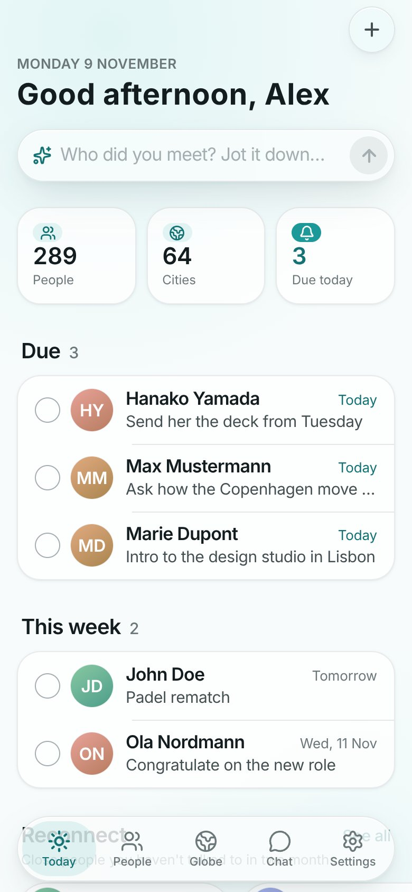
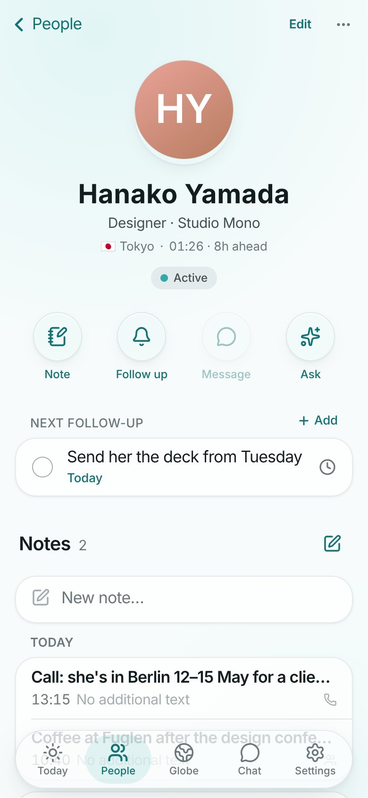
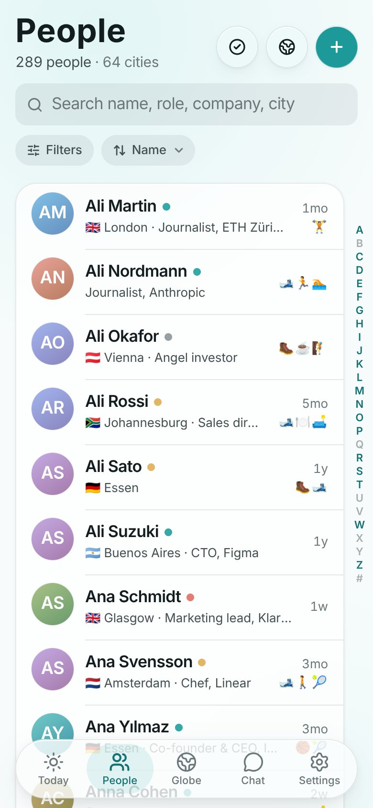
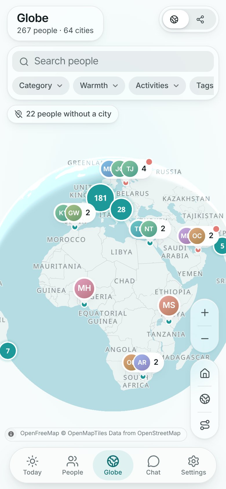

# The Network

**A private vault for everyone you've met.**

[**thenetwork-app.vercel.app**](https://thenetwork-app.vercel.app)

You meet someone at a conference, over coffee, on a trip. Three months later you remember the face,
but not what they're working on, who introduced you, or that you promised to send them something.
The Network is where all of that goes: one card per person with your notes, where they live, how you
met, and a follow-up that reminds you when it's time to reach out again.

It's a personal relationship manager for anyone whose circle keeps growing: founders and investors,
but just as much students, people who move cities, people who travel, anyone who'd rather not lose
touch. You host it yourself, it has exactly one owner, and your notes never leave your own database.

[](https://github.com/uraruguy/the-network/actions/workflows/ci.yml)
[](LICENSE)

| Today | A person | People | Globe |
| :---: | :---: | :---: | :---: |
|  |  |  |  |

<sub>Screenshots from a fresh install with generated demo people.</sub>

## What it does

- **A card for everyone.** Notes in a calm, Apple Notes-style editor (note, meeting, call, message),
  plus categories, warmth, tags, activities, home city, how you met and who introduced you.
- **Follow-ups that find you.** "Tomorrow", "in 2 weeks", "in 3 months" or a date, optionally
  repeating. Today shows what's due and who you haven't talked to in a while; a daily e-mail digest
  has one-tap *Done* and *Snooze*. Mark one done with a note on what you sent or said, and it stays
  in that person's follow-up history.
- **Find anyone in a second.** Instant search that ignores accents, filters by category, warmth,
  activity, tag and city, and an A–Z index. Select many at once to tidy up; removed people wait in
  *Recently deleted*, so nothing is ever lost.
- **Your people on a globe.** A calm MapLibre globe with city clusters, plus a graph of who
  introduced whom.
- **Ask your network.** An AI assistant with tools over everything you've written ("who do I know in
  Lisbon who climbs?", "add a note to Ana: …"). Bring your own Anthropic or OpenRouter key.
- **Use it from Claude.** A built-in MCP server lets Claude, ChatGPT, Cursor or any MCP client read
  (and, if you allow it, add to) your network. [docs/mcp.md](docs/mcp.md)
- **Bring what you already have.** Paste any text (a note, an e-mail, a call transcript) and the AI
  files it under the right people. Years of Apple Notes can be imported in bulk, with you confirming
  the unsure matches. [docs/import.md](docs/import.md)
- **Works like an app.** Install it on iPhone and Mac; it opens instantly, works offline and syncs
  when you're back online.
- **Private by design.** One owner, no sign-up, password plus passkey (Face ID / Touch ID), strict
  headers, encrypted keys, and a one-click JSON export. [SECURITY.md](SECURITY.md)

## Install it like an app

There's nothing to download from an App Store: you host The Network (below), then add your own URL
to your devices. It opens in its own window, keeps working offline and syncs when it's back online.

- **iPhone / iPad:** Safari → Share → *Add to Home Screen*.
- **Mac:** Safari → File → *Add to Dock* (macOS Sonoma or later). In Chrome: ⋮ → *Cast, save and
  share* → *Install page as app*.

## Quick start (local)

You need [Node 22](https://nodejs.org), pnpm 12 (`npm install -g pnpm@12`),
[Docker](https://www.docker.com/products/docker-desktop/) and the
[Supabase CLI](https://supabase.com/docs/guides/local-development).

```bash
git clone https://github.com/uraruguy/the-network.git && cd the-network
pnpm install
supabase start          # local Postgres + Auth in Docker; applies supabase/migrations
pnpm bootstrap          # writes .env.local (keys + generated secrets) and creates your owner account
pnpm db:seed-cities     # world cities for city search and the globe (once per database)
pnpm dev                # http://localhost:3100
```

Sign in with the account `pnpm bootstrap` created and add a passkey (Settings → Security). Then:

1. **Settings → Profile:** your name, home city and time zone (the digest and "today" use it).
2. **Settings → AI & e-mail:** an Anthropic or OpenRouter key for the assistant and imports, and
   Resend or any SMTP server for the digest. Both are optional.
3. **Settings → Setup checklist:** whatever this install still needs.

Want something to click around in first? `pnpm exec tsx scripts/dev/seed-people.ts seed 150` adds
fake people (local databases only; `… clean` removes them).

`pnpm bootstrap` is safe to re-run: it never changes a value that is already set and only prints the
names of the keys it adds. It creates the owner only against a local Supabase. Options:
`pnpm bootstrap --help`. Every variable is documented in [.env.example](.env.example).

> Use `http://localhost:3100`, not `127.0.0.1`: the passkey relying party is the hostname of
> `NEXT_PUBLIC_APP_URL`. Prefer working without passkeys locally? Add `AUTH_REQUIRE_PASSKEY=false` to
> `.env.local`.

## Deploy (Supabase + Vercel)

**1. Supabase project.** Create one and note its region. Then, from this repo:

```bash
supabase link --project-ref <ref>
supabase db push                                   # applies supabase/migrations
DATABASE_URL='<session or direct connection string>' pnpm db:seed-cities
```

**2. Supabase Auth** (Dashboard → Authentication):

- **Sign In / Providers:** turn *Allow new users to sign up* off.
- **Users → Add user → Create new user** with your e-mail and a strong password, *Auto Confirm* on.
  The first account claims the instance; the database rejects any other e-mail.
- **Policies:** minimum length 12, letters and digits, leaked-password protection on.
- **URL Configuration:** Site URL = your app URL; add `https://<your-app>/auth/callback` to the
  redirect URLs (password reset).
- **JWT Keys:** asymmetric signing keys (sessions are then verified without a round trip).
- **OAuth Server** (only for claude.ai / ChatGPT connectors): see [docs/mcp.md](docs/mcp.md#production-checklist).

**3. Vercel.** Import the repo (framework: Next.js) and set these environment variables:

| Variable | Value |
| --- | --- |
| `NEXT_PUBLIC_SUPABASE_URL`, `NEXT_PUBLIC_SUPABASE_ANON_KEY` | Project Settings → API |
| `DATABASE_URL` | Connect → **Transaction pooler** (port 6543) |
| `NEXT_PUBLIC_APP_URL` | `https://<your-app>`: the passkey domain, set it once and keep it |
| `APP_SECRET` | `openssl rand -base64 48` |
| `CRON_SECRET`, `INBOX_TOKEN` | `openssl rand -hex 24` each |
| AI and e-mail | optional; can be set in the app instead (see [Connections](#connections)) |

Leave `AUTH_REQUIRE_PASSKEY` unset (passkeys required) and don't add `SUPABASE_SERVICE_ROLE_KEY`; the
app never uses it.

**Region:** set Project Settings → Functions → **Function Region** to the one closest to your
Supabase region (e.g. Supabase `eu-central-1` → Vercel `fra1`). Every request makes several database
round trips; an ocean in between adds up fast.

**4. Digest schedule.** `vercel.json` calls `/api/cron/reminders` daily at 06:00 UTC (Vercel sends
`Authorization: Bearer $CRON_SECRET`). For the digest at *your* hour, let Postgres call it hourly
(pg_cron + pg_net), once, in the Supabase SQL editor:

```sql
select private.set_digest_target('https://<your-app>', '<CRON_SECRET>');
```

Both schedules can run together: each day's digest is claimed atomically and sent once.

**5. First sign-in.** Open the app, sign in, and **immediately** enroll a passkey: until the first one
exists, the password alone may enroll one. Save the recovery codes, add a second passkey from your
other device, then work through Settings → Setup checklist. The full release checklist is in
[SECURITY.md](SECURITY.md#release-checklist).

Then [install it](#install-it-like-an-app) on your phone and Mac from your own URL.

## Security model

- **One owner.** No sign-up screen, sign-ups off in Supabase, and a database trigger that rejects
  any account but the first.
- **Two factors.** Supabase checks the password; the app adds its own passkey factor (WebAuthn via
  SimpleWebAuthn) with an HMAC-signed cookie bound to the Supabase session. The proxy and every API
  handler (`withOwner`) require both. 10 one-time recovery codes; alerts by e-mail.
- **Keys you hold.** `APP_SECRET` derives every key the app uses (HKDF): passkey cookie, WebAuthn
  challenges, recovery-code hashes, signed e-mail links, encryption of stored API keys.
- **Headers.** HSTS, `nosniff`, `X-Frame-Options: DENY`, COOP, a strict Permissions-Policy, `noindex`,
  and a CSP with per-request nonces on the sign-in pages (report-only until you enforce it).
- **Data API closed.** The app reaches Postgres directly; migrations revoke all Data API grants from
  `anon`/`authenticated`, and RLS stays on as a second layer.
- **Offline cache is wiped on sign-out**, the service worker never caches API or auth responses, and
  MCP clients get scoped, rate-limited, audited access with no delete tools.

Details, threat model and vulnerability reporting: [SECURITY.md](SECURITY.md).

## Connections

**Settings → AI & e-mail** holds the outside services, so a fresh deploy needs no AI or mail keys in
its environment:

- **AI:** Anthropic or OpenRouter, an API key and a main/fast model (picked from the provider's live
  model list). Used by the chat, paste-a-note import and AI triage. *Test* sends one real request.
- **E-mail:** Resend (API key) or any SMTP server, plus the sender. Used by the digest and security
  alerts. *Send test e-mail* checks it.

Keys are encrypted with a key derived from `APP_SECRET` before they reach the database, and only
their last characters are ever shown again.

**Environment variables win.** If `ANTHROPIC_API_KEY`, `OPENROUTER_API_KEY` or `AI_PROVIDER` (AI), or
`RESEND_API_KEY` / `SMTP_URL` (e-mail) are set, Settings shows the connection as *Managed by
environment*, read-only. `AI_PROVIDER=agent-sdk` (your Claude subscription through the local Claude
Code CLI) exists only as an environment setting, for your Mac. `AI_CHAT_MODEL` / `AI_CHAT_MODEL_FAST`
override the chat's models alone. The import CLI reads the environment and its `--provider` flag.

## MCP

The server lives at `https://<your-app>/api/mcp` (Streamable HTTP) and exposes the same tools as the
in-app assistant: search people, read notes, places, follow-ups, and with write access add notes,
people and follow-ups. Full guide: [docs/mcp.md](docs/mcp.md).

- **Claude Code:** Settings → Connected apps → *New token* (shown once), then run this and paste the
  token at the prompt, so it never lands in your shell history:
  ```bash
  read -rs "NTK?Network token: " && claude mcp add --transport http --scope user network https://<your-app>/api/mcp --header "Authorization: Bearer $NTK"; unset NTK
  ```
  (`read -rs NTK` in bash.) `claude mcp list` should then show `network` as connected.
- **claude.ai** (web, desktop, mobile): Settings → Connectors → *Add custom connector* → your server
  URL → sign in with password + passkey → choose *Read only* or *Read & write* → *Allow*. Needs the
  Supabase OAuth server ([checklist](docs/mcp.md#production-checklist)).

Revoke tokens and disconnect apps any time in Settings → Connected apps.

## Apple Notes import

```bash
pnpm notes:export --clean                                                    # on the Mac with Notes
pnpm import:ingest .cache/notes-export.clean.json --env .env.cloud.local --yes-prod --write
pnpm import:screen  --env .env.cloud.local --yes-prod --write                # AI, on your Claude subscription
pnpm import:extract --env .env.cloud.local --yes-prod --write
pnpm import:prepare --env .env.cloud.local --yes-prod                        # packets + brief for Claude subagents
# … subagents write resolutions/, then validate → apply → reconcile → file
```

The prompts know your name from your profile; set `IMPORT_CONTEXT` for a line about you (who you
are, which languages your notes are in) `IMPORT_PERSON_FOLDERS` for folders you named after a person
and `IMPORT_JOURNAL_FOLDERS` for diary folders. Then review in the app (**Import → Apple Notes**): one card per person, approve, reject or merge;
keyboard on the Mac, swipes on the iPhone. Commit when ready; undo from the same screen or with
`pnpm import:rollback`.

Every pipeline command is a **dry run without `--write`**, refuses a non-local database without
`--yes-prod`, and logs each committed row so a rollback is exact. AI stages default to `agent-sdk`
(paid keys need `--allow-paid`) and can hand their work to Claude Code subagents instead (`--emit`).
Step by step, with the subagent workflow and a rehearsal on a local copy:
[docs/import.md](docs/import.md).

Two cards for one person: **More → Merge with…** on either (People suggests same-name pairs).

Shorter: **Import → Paste a note** takes any text (a note, an e-mail, a call transcript), finds the
people and files it after you confirm.

### "Send to The Network" iPhone Shortcut

A Shortcut with **Get Contents of URL**: `POST https://<your-app>/api/inbox`, header
`Authorization: Bearer <INBOX_TOKEN>`, JSON body `text` = *Shortcut Input*, `source` = `shortcut`.
Turn on *Show in Share Sheet*; shared text lands in the inbox on Today for AI triage.

## Scripts

| Command | What it does |
| --- | --- |
| `pnpm dev` | Dev server on http://localhost:3100 (service worker off: it would fight Fast Refresh) |
| `pnpm dev:sw` | Dev server with the service worker and its watcher (`NEXT_PUBLIC_SW_DEV=1`), to test offline |
| `pnpm build` / `pnpm start` | Production build (Next.js + Serwist service worker) / serve it on :3100 |
| `pnpm typecheck` | `next typegen` (route types) + `tsc --noEmit` |
| `pnpm lint` / `pnpm lint:design` | ESLint / design-token lint for `src/components` (`--strict` in CI) |
| `pnpm test` | Vitest unit tests (`TEST_DATABASE_URL=… pnpm test` adds the local database tests) |
| `pnpm bootstrap` | First-run setup: `.env.local`, secrets, local owner account |
| `pnpm db:seed-cities` | Load GeoNames cities (pop. ≥ 15 000, CC BY 4.0) into `cities` |
| `pnpm db:generate` | Drizzle schema diff → paste into a new `supabase/migrations/*.sql` |
| `pnpm notes:export` / `notes:clean` | Export Apple Notes to `.cache/` / strip inline images |
| `pnpm import:*` | The import pipeline: `backup`, `diff`, `ingest`, `screen`, `extract`, `prepare`, `validate`, `apply`, `reconcile`, `file`, `review`, `commit`, `verify`, `spotcheck`, `rollback` ([docs/import.md](docs/import.md)) |
| `pnpm dev:cloud` | Dev server against `.env.cloud.local` (your cloud database) |
| `pnpm notes:import` / `notes:resume` | Legacy one-shot importer (v1 jobs) |

Run with `pnpm tsx scripts/…`:

| Script | What it does |
| --- | --- |
| `seed-dev-user.ts` | Local owner `dev@local.test` (superseded by `pnpm bootstrap`) |
| `dev/seed-demo.ts seed` / `clean` | Local only: the placeholder cast from the screenshots (Hanako Yamada, John Doe, …) |
| `dev/seed-people.ts seed [n]` / `clean` | Local only: fake people for list and filter testing |
| `dev/globe-seed.ts [--remove]` | Local only: fake people across 40 cities for the globe |
| `send-test-digest.ts you@example.com` | Send today's digest through the configured transport |
| `ai-smoke.ts` | One structured call and one tool call against the configured AI |
| `db/readonly-query.ts "select …"` | SQL inside a read-only transaction (`--env` for another database) |
| `cleanup-empty-notes.ts [--apply]` | Soft-delete empty notes (dry run by default; `--yes-prod` for cloud) |

## Architecture

```
src/
  app/            Next.js App Router: (app) screens, (auth) sign-in + OAuth consent, api/ route handlers,
                  .well-known/ OAuth metadata, r/ e-mail action pages, sw.ts service worker
  components/     ui/ (Base UI primitives: Sheet, Menu, Select, ConfirmDialog …) and feature folders
                  (people, notes, globe, graph, chat, import, settings, today, shell)
  lib/
    data/         server data access (Drizzle); every query is scoped by ownerId
    queries/      TanStack Query hooks, mutation defaults, offline-safe writes
    auth/ security/ crypto/   sessions, passkeys, CSP and headers, HKDF keys, secret encryption
    ai/           providers, prompts, and the tool registry (ai/tools) shared by chat and MCP
    mcp/          MCP server, token and OAuth verification
    connections/  AI and e-mail settings (env first, then Settings), setup checklist
    import/       pure import logic: names, clustering, policy, filing, validation
  proxy.ts        auth gate for every request (JWT + passkey cookie), nonce CSP for sign-in pages
supabase/         config.toml (local stack) and migrations/ (plain SQL, additive)
scripts/          bootstrap, seeds, Apple Notes export, import pipeline (scripts/import)
test/             test setup and opt-in database tests
docs/             mcp.md, import.md
```

Stack: Next.js 16 (App Router, Turbopack) · React 19 · TypeScript · Tailwind v4 · Base UI ·
Motion · Supabase (Postgres + Auth) · Drizzle ORM · TanStack Query (IndexedDB persistence) ·
MapLibre GL · react-force-graph · Tiptap 3 · Vercel AI SDK (Anthropic, OpenRouter, Claude Agent SDK) ·
MCP SDK · SimpleWebAuthn · Resend / Nodemailer · Serwist.

## Break-glass

Run SQL in the Supabase SQL editor (or `psql` as `postgres`).

**Lost every passkey and the recovery codes.** Remove them, then sign in with your password and enroll
a new passkey straight away (until one exists, a password session may enroll the first):

```sql
delete from webauthn_credentials where owner_id = (select id from profiles limit 1);
delete from mfa_recovery_codes   where owner_id = (select id from profiles limit 1);
```

**Forgot the password.** *Forgot password?* on the sign-in screen e-mails a reset link (or Dashboard →
Authentication → Users → *Send password recovery*). The reset page doesn't need the passkey; your data
still does.

**Rotate `APP_SECRET`.** Set `APP_SECRET_PREVIOUS` to the current value and `APP_SECRET` to a new one
(`openssl rand -base64 48`), redeploy. Old passkey cookies, e-mail links and stored keys keep working.
Then open Settings → Connections once: stored AI and e-mail keys are re-encrypted with the new secret
whenever they're read or saved (chat and the daily digest do it too), and the status there shows any
key that can't be read. Regenerate recovery codes (Settings → Security). After 30 days (cookie and
link lifetime) remove `APP_SECRET_PREVIOUS`.

**A device or token is compromised.** Settings → Security → *Sign out other devices*; Settings →
Connected apps → revoke tokens and disconnect apps; then change the password.

## Contributing

See [CONTRIBUTING.md](CONTRIBUTING.md). Security issues: [SECURITY.md](SECURITY.md), please not in
public issues.

## License

[MIT](LICENSE) © 2026 Jakob Kavčič. City data © [GeoNames](https://www.geonames.org/) (CC BY 4.0);
map tiles © [OpenFreeMap](https://openfreemap.org/), © OpenMapTiles, © OpenStreetMap contributors.
